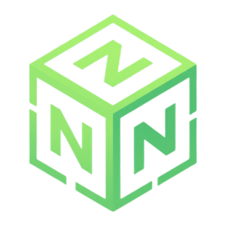

# NEXIUM

**NEXIUM is a Minecraft launcher for Windows. Install the game and modpacks, create separate instances, and configure your launch settings in one app.**

[Download NEXIUM](https://github.com/NexiumLauncher/asdazxc/releases/latest) · [All releases](https://github.com/NexiumLauncher/asdazxc/releases)

## Features

- **Game library.** Create separate Minecraft instances with their own files and folders. Launch, rename, and favorite your instances.
- **Minecraft versions and mod loaders.** Install Minecraft versions and create instances with supported mod loaders.
- **Modrinth catalog.** Find and install modpacks, mods, resource packs, and shaders.
- **Launch settings.** Choose Java or automatic runtime selection, allocated memory, Minecraft language, and what the launcher does when the game starts.
- **Personalization.** Customize the launcher's appearance and background.
- **Discord Rich Presence.** Show friends which launcher tab you're viewing, which Minecraft version you're playing, or which modpack you're running.
- **Instance files.** Open an instance folder and add your own mods, resource packs, and other files.

## Installation

1. Go to the [latest release](https://github.com/NexiumLauncher/asdazxc/releases/latest).
2. Download the NEXIUM installer from **Assets**.
3. Run the `.exe` and follow the setup instructions.
4. Create an instance, choose a game version or modpack, and click **Play**.

To update, download and run the installer from a newer release. Your game instances are stored separately from the launcher.

## Modpacks and game files

Each instance has its own folder. To change its contents, open the instance folder from the launcher, add or remove files in the appropriate directories, and restart Minecraft. If a modpack author asks you to download additional files manually, use the links and instructions provided by the author.

## Support

Found a bug or have an idea? Open an [issue](https://github.com/NexiumLauncher/asdazxc/issues).

NEXIUM is an independent project and is not affiliated with Mojang Studios or Microsoft. Minecraft is a trademark of Mojang Studios.
